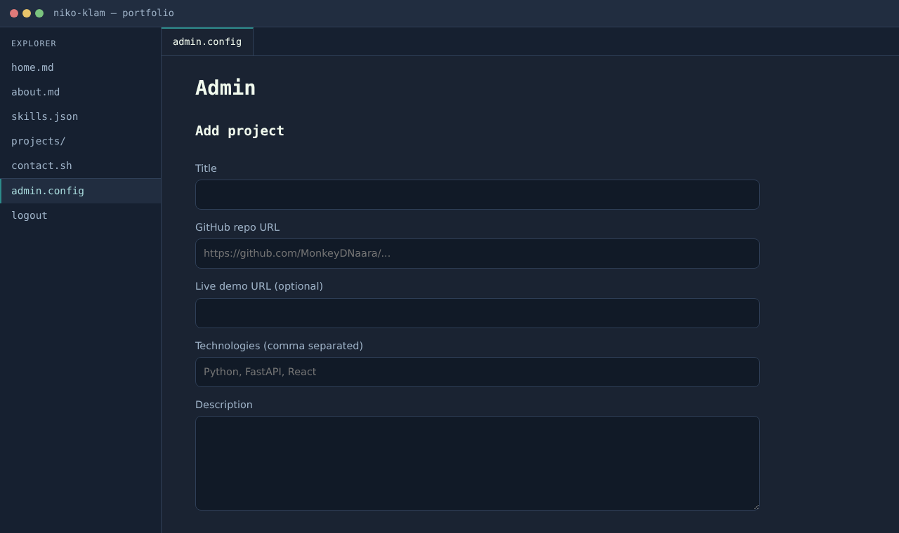
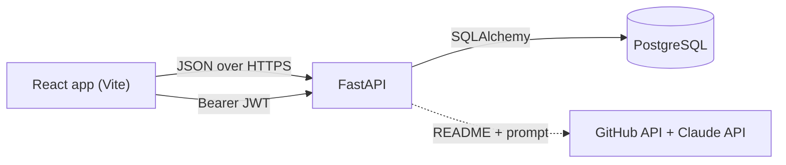

# Portfolio

[](https://github.com/MonkeyDNaara/Portfolio/actions/workflows/ci.yml)

My portfolio site, built as a small but complete full-stack project. It shows my other projects, and I can log in as admin to add, edit and delete them without touching the code. I came from industrial automation, so I wanted a project that shows the whole path: database, API, auth, frontend, tests, CI and deployment.


|  Projects (git-log style) | Admin page |
| --- | --- |
|  |  |

## What it does

- Public pages: home, about, skills, projects list, project detail and contact
- Admin login (JWT) and an admin page to add, edit and delete projects
- Optional AI helper: drafts a project description from a repo's README using the Claude API, I always edit it before saving
- Responsive layout, works on a phone too

## Tech stack

| Part | What I used |
| --- | --- |
| Backend | Python, FastAPI, SQLAlchemy 2, Alembic, PyJWT |
| Database | PostgreSQL (Neon), SQLite for local dev and tests |
| Frontend | React, Vite, React Router, plain CSS |
| Quality | pytest (27 tests), ruff, GitHub Actions |
| Deployment | Docker / docker-compose, Render (see `render.yaml`) |

## How it fits together



Reading projects is public. Everything that changes data (`POST`, `PUT`, `DELETE`, the AI endpoint) needs a valid token.

## Run it locally

You need Python 3.10+ and Node 20+.

**Backend**

```bash
cd backend
python -m venv .venv && source .venv/bin/activate
pip install -r requirements-dev.txt
cp .env.example .env        # then set JWT_SECRET and ADMIN_PASSWORD
alembic upgrade head        # creates the tables
python -m app.seed          # optional: adds my projects
uvicorn app.main:app --reload
```

The API docs are at <http://localhost:8000/docs>. The admin user is created on startup from `ADMIN_USERNAME` and `ADMIN_PASSWORD`.

**Frontend**

```bash
cd frontend
cp .env.example .env
npm install
npm run dev
```

**Or with Docker** (API + Postgres):

```bash
cp .env.example .env        # set JWT_SECRET and ADMIN_PASSWORD
docker compose up --build
```

## Tests

```bash
cd backend
pytest -q
ruff check .
```

The tests cover login, token handling, protected routes, validation, CRUD, the seed script and the AI endpoint (with GitHub and Claude mocked). CI runs the same checks plus the frontend build on every pull request.

## Deployment

`render.yaml` describes two Render services (API and static site). The database is a Neon Postgres. Steps:

1. Create a Neon project and copy the connection string.
2. On Render, create a Blueprint from this repo and fill in `DATABASE_URL`, `ADMIN_USERNAME`, `ADMIN_PASSWORD`, `CORS_ORIGINS` (the frontend URL) and `VITE_API_URL` (the API URL).
3. Seed the projects once from my machine: `DATABASE_URL=<neon url> python -m app.seed`.

The free Render tier goes to sleep, so the first request after a while can take around 30 seconds.

## Decisions and trade-offs

- **FastAPI** because I like Python and I get validation and OpenAPI docs almost for free.
- **Passwords** are stored as salted PBKDF2-HMAC-SHA256 hashes (200k iterations) and compared in constant time. There is no public registration route, the only user is created from environment variables.
- **JWT in `localStorage`** is simple but readable by injected scripts. For a single-admin portfolio I accepted that. For something bigger I would use an httpOnly cookie.
- **Secrets** only come from environment variables, `.env` is git-ignored.
- **The AI endpoint** only returns a draft and never saves anything. The README is treated as untrusted input in the prompt.

## What I would do next

- Rate limiting on the login route
- Frontend tests (Vitest and React Testing Library)
- Refresh tokens or cookie-based sessions

## Project layout

```
backend/    FastAPI app, Alembic migrations, tests
frontend/   React + Vite app
legacy/     my first static version of this site
.github/    CI workflow
```
